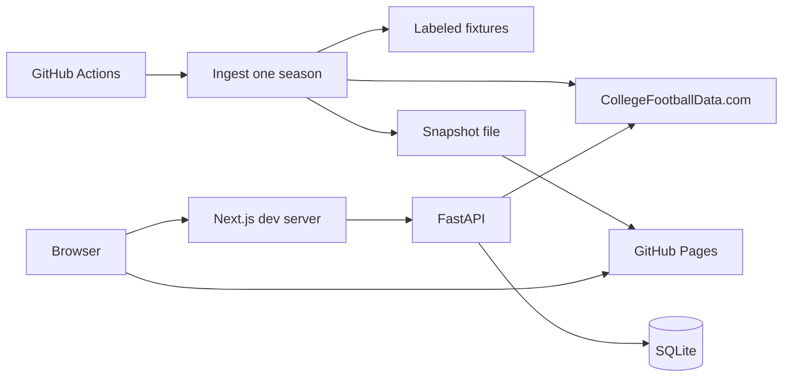

# College Football Intelligence Platform

CFIP is a sourced team ledger for college football. An analyst picks a season and a team and sees the season stats and results that were stored for that team, with the source and the time they were fetched.

It is not a betting product. It does not show odds, spreads, or picks. It does not predict games. It does not call a language model.

Product direction is by Chinedu Onyemaobi. The implementation was built by an AI coding agent under his direction. The repository is not a claim that he typed the code line by line.

## Live demo

Expected public URL, after the Pages workflow has run on `main` and GitHub Pages is enabled:

**https://therealnedu.github.io/college-football-intelligence/**

That URL was not opened from this environment. The workflow that publishes it is `.github/workflows/pages.yml`. It runs on a push to `main`, on a manual run, and every Monday at 14:00 UTC. It does not run from a pull request, and this agent cannot turn on the repository's Pages setting.

Until a key is added, the published page is the labeled fixture snapshot. The banner says the numbers are not real college football statistics. After the key is saved and the workflow runs again, the same page is rebuilt from CollegeFootballData.com for one season and the banner says so.

A long-running API host is not part of this demo. The 2026-11-10 notes on Render, Neon, and Cloudflare are still in [docs/03-free-technology-assessment.md](docs/03-free-technology-assessment.md). Those accounts are optional and are not set up.

## What is live and what is planned

| Area | State |
| --- | --- |
| Season and team selection, stored stats, source, timestamp | Live in the API and in the static snapshot |
| Games for the stored season, with a blank score left blank | Live. Loaded by the ingest command. Opening the page does not call the provider for games |
| Fixture mode, labeled synthetic data | Live. Used when no key is configured |
| Live CollegeFootballData.com client, cache, retries, rate-limit fail-fast | Implemented and tested with mocks. Not executed against the provider here, because no key was available |
| Ingest of one season: teams, games, and season stats in three calls | Implemented. Idempotent load. Tested with synthetic recorded responses. CI does not need a key |
| Static snapshot and GitHub Pages workflow | Implemented. The public URL is not verified until Pages is enabled and the workflow runs on `main` |
| Two-team comparison, saved analyst notes | Planned. Not built |
| Grounded questions, scouting reports, an evaluation set | Planned. No model is called |
| Tool-calling agent and execution metrics | Planned |
| Postgres | A URL is accepted by SQLAlchemy. Not tested |

## How data flows

1. GitHub Actions starts the Pages workflow.
2. If the repository secret `CFBD_API_KEY` is set, the job asks CollegeFootballData.com for one season. That is three calls: the team list, the games, and the season stats. It waits between calls. If the provider's remaining-quota header is below the guard, it does not start the next call.
3. If the secret is missing, the job loads the labeled synthetic fixtures and does not call the network.
4. The job writes a snapshot file in CFIP's own fields. Raw provider bodies, logos, and betting fields are not written. The file is not committed.
5. Next.js is exported to static files. GitHub Pages serves them. The browser does not hold the key and does not call CollegeFootballData.com.
6. The page shows the source, whether the copy is live or fixture, and when the snapshot was built.

Locally, the same ingest command can fill SQLite, and the Next.js app can proxy to the API instead of reading a snapshot. A second read inside 24 hours is served from SQLite.



The public demo is the Pages path. The API path is the local app. Detail is in [docs/02-architecture.md](docs/02-architecture.md).

## What you do to turn it on

The workflow cannot enable Pages, and it cannot request a key for you.

1. **Publish the site.** Open [Pages settings](https://github.com/therealnedu/college-football-intelligence/settings/pages). Set **Source** to **GitHub Actions**. Merge this change to `main` so the workflow runs. The expected site is https://therealnedu.github.io/college-football-intelligence/ . If the first run fails with a Pages error, the source is still not GitHub Actions. The page will show labeled fixture data until step 2.
2. **Switch the page to real data.** Request a free key at [collegefootballdata.com/key](https://collegefootballdata.com/key) (the page checked on 2026-11-10 asked for an email address and did not ask for a card). Add it as a repository secret named exactly `CFBD_API_KEY` at [Actions secrets](https://github.com/therealnedu/college-football-intelligence/settings/secrets/actions). Then run the [Pages workflow](https://github.com/therealnedu/college-football-intelligence/actions/workflows/pages.yml) with **Run workflow**, or wait for Monday 14:00 UTC. The rebuild uses about three provider calls. The banner changes from the fixture warning to CollegeFootballData.com.

Do not put the key in a file that gets committed. Local use is the same variable in `.env`, copied from `.env.example`.

## Architecture

The browser on the public site reads a static snapshot. The browser in local development talks only to the Next.js app, which proxies `/cfip-api` to FastAPI. FastAPI reads and writes SQLite. In live mode, a cache miss for teams or one team's stats calls CollegeFootballData.com. The key stays on the server. In fixture mode, the API reads labeled synthetic files and does not call the network.

The ingest command is the path that loads a whole season, including games. The web request for games only reads what is already stored. That keeps a public page, and a curious refresh, from spending the 1,000-call month.

The snapshot is one season, FBS when the load is live (`CFIP_INGEST_CLASSIFICATION`, default `fbs`). The season is the previous calendar year unless you pass another year. That is a bound on how much of the provider's catalog is copied into the public page. It is a display inside this product, not a raw feed and not a substitute API. The terms summary used for that decision is the one recorded on 2026-11-10 in [docs/03-free-technology-assessment.md](docs/03-free-technology-assessment.md).

## Setup

Python 3.12 and Node.js 22. No paid account is required to run the tests or the fixture UI.

```bash
python3 -m venv backend/.venv
backend/.venv/bin/pip install -r backend/requirements.txt -r backend/requirements-dev.txt
npm ci --prefix frontend
```

Optional, for live data: copy `.env.example` to `.env` and set `CFBD_API_KEY`. Leave the key out of git.

## Run

Fixture review (no key, synthetic data, banner on the page):

```bash
cd backend
CFIP_DATA_MODE=fixture .venv/bin/uvicorn app.main:app --host 0.0.0.0 --port 43124
```

In another shell:

```bash
cd frontend
npm run dev
```

Open http://127.0.0.1:43123 . The page calls `/cfip-api`, and Next.js proxies that to port 43124.

Load a season into SQLite, including games, and write a snapshot file:

```bash
cd backend
CFIP_DATA_MODE=fixture .venv/bin/python -m app.ingest --season auto --snapshot ../frontend/public/data/snapshot.json
```

`--season auto` is the previous calendar year. `--force` ignores the 24-hour cache. `--allow-fixture-fallback` uses the labeled fixtures when the key is missing instead of exiting. The Pages workflow passes both of those flags. A second run without `--force` does not call the provider again while the cache is fresh, and it does not insert a second copy of the rows.

Live mode, after a key is in the environment or in `.env`:

```bash
cd backend
CFIP_DATA_MODE=live .venv/bin/uvicorn app.main:app --host 0.0.0.0 --port 43124
```

Use a different SQLite file than a fixture session, or delete `backend/data/cfip.db` first. Live and fixture rows are stored under different data sources.

Build the static site the way Actions does:

```bash
cd backend
CFIP_DATA_MODE=fixture .venv/bin/python -m app.ingest --season 2025 --force --snapshot ../frontend/public/data/snapshot.json
cd ../frontend
CFIP_STATIC_EXPORT=true NEXT_PUBLIC_DATA_SOURCE=snapshot NEXT_PUBLIC_BASE_PATH=/college-football-intelligence npm run build
```

The export is `frontend/out`. The snapshot file is gitignored.

## Test

```bash
cd backend && .venv/bin/pytest -q
cd frontend && npm test
```

CI is `.github/workflows/ci.yml`. It runs those tests, a frontend production build, and a fixture snapshot export. It does not call the data provider.

Live smoke, two provider calls, then cache checks. It does not assert statistic values:

```bash
cd backend
export CFBD_API_KEY='your-key'
export CFIP_DATA_MODE=live
.venv/bin/pytest -m live -q
```

### Get a free key

1. Open https://collegefootballdata.com/key (page checked 2026-11-10: email address, no credit card).
2. Put the key from the email in `CFBD_API_KEY`, or in the Actions secret of the same name.
3. For a local check, run the smoke command above from `backend`.
4. Expect two calls against the free monthly quota of 1,000. A second run inside 24 hours should be served from SQLite if you point it at the same database. The pytest uses a temporary database, so each pytest run spends two calls. The Pages ingest spends about three calls for one season.

If the smoke test fails, the failure is the verification. Do not replace it with a handwritten stat.

## Environment

| Variable | Role | Default |
| --- | --- | --- |
| `CFBD_API_KEY` | Bearer key. Server and Actions only | empty |
| `CFIP_DATA_MODE` | `live` or `fixture` | `live` |
| `CFBD_BASE_URL` | Provider origin | `https://api.collegefootballdata.com` |
| `CFBD_TIMEOUT_SECONDS` | Per-attempt timeout | `20` |
| `CFBD_MAX_RETRIES` | Attempts including the first | `3` |
| `CFBD_BACKOFF_SECONDS` | Base backoff. Doubles each retry | `0.5` |
| `CFBD_CACHE_TTL_SECONDS` | Freshness of a successful refresh | `86400` |
| `CFIP_INGEST_CLASSIFICATION` | Live ingest filter. Fixture ingest ignores it | `fbs` |
| `CFIP_INGEST_PAUSE_SECONDS` | Wait between ingest calls | `1` |
| `CFIP_INGEST_MIN_REMAINING` | Stop before the next call when the remaining-quota header is below this | `25` |
| `DATABASE_URL` | SQLAlchemy URL. Relative SQLite paths resolve under `backend/` | `sqlite:///./data/cfip.db` |
| `CFIP_CORS_ORIGINS` | Used when the browser calls the API directly | local UI origins |
| `CFIP_LOG_LEVEL` | Python log level | `INFO` |
| `CFIP_AUTO_MIGRATE` | Apply Alembic on startup | `true` |
| `CFIP_API_PROXY_TARGET` | Where Next.js sends `/cfip-api` | `http://127.0.0.1:43124` |
| `NEXT_PUBLIC_API_BASE_URL` | Override the UI's API prefix | `/cfip-api` |
| `CFIP_STATIC_EXPORT` | `true` writes a static site instead of a Node server | unset |
| `NEXT_PUBLIC_DATA_SOURCE` | `snapshot` reads the built snapshot. Anything else uses the API | unset |
| `NEXT_PUBLIC_BASE_PATH` | Path prefix for the Pages site | unset |

## Docs

| Doc | Contents |
| --- | --- |
| [docs/01-product-definition.md](docs/01-product-definition.md) | Problem, users, use cases, MVP, value |
| [docs/02-architecture.md](docs/02-architecture.md) | Components, flow, errors |
| [docs/03-free-technology-assessment.md](docs/03-free-technology-assessment.md) | $0 hosting, data terms, later model choice. Sources and access dates |
| [docs/04-database-design.md](docs/04-database-design.md) | Schema and ER diagram |
| [docs/05-product-backlog.md](docs/05-product-backlog.md) | Epics, stories, acceptance |
| [docs/06-roadmap.md](docs/06-roadmap.md) | Phases, risks, decisions, tests |
| [docs/08-portfolio-value.md](docs/08-portfolio-value.md) | What this shows in a TPM / PM interview |

## Verification on 2026-11-11

Run in this environment. `CFBD_API_KEY` was not set. CollegeFootballData.com was not called.

Backend (`pytest -q`): 26 passed, 1 skipped. The skip was `tests/test_live_smoke.py`.

Frontend (`npm test`): 10 passed. `npm run build` compiled the Next.js app. A second build with `CFIP_STATIC_EXPORT=true` wrote `frontend/out`. The exported `index.html` contains the fixture banner, the phrase `NOT REAL COLLEGE FOOTBALL STATISTICS`, and `Fixture Falcons University`. The snapshot JSON does not contain betting keys or logos.

The static export was served at http://127.0.0.1:8765/college-football-intelligence/ and exercised in a browser: the fixture banner, the three synthetic schools, Falcon stats including `1,234` and a non-numeric `99:99`, a stored result `10` at `24`, a scheduled result whose score is blank rather than zero, the empty-roster state, and a filter that matches nothing. Those numbers are the fixture file. They are not football statistics.

An unauthenticated probe of the provider on 2026-11-10 returned HTTP 401 for `GET /teams` and `GET /stats/season`, and HTTP 404 for `GET /stats/team/season`. No stat payload was returned. This run did not repeat that probe.

The Pages deploy was not run. It publishes from `main` after GitHub Pages is set to GitHub Actions.

## Data attribution and licensing

Live figures, when a key is configured, come from [CollegeFootballData.com](https://collegefootballdata.com), operated by Rad Sports Analytics LLC. CFIP is not that service, and it is not an official NCAA, conference, or school source.

Their API terms govern the data. The copy read for this project was effective 2026-08-12: [Terms of Use](https://collegefootballdata.com/terms). In short, a private cache and a reasonable display inside a product are allowed. A raw feed, a public database mirror, and a substitute API are not. The key stays on the server. This repository does not contain a key, a raw provider payload, or a dump of their data. The public snapshot is one season of normalized fields, built in Actions and not committed.

Live responses and a live snapshot use their suggested attribution: "Data provided by CollegeFootballData.com." School names identify the subject of a stored row. Logos are not stored. Betting routes are not called.

The [MIT license](LICENSE) covers this repository's code and documents. It does not license CollegeFootballData.com's data. Files under `backend/fixtures/` and `backend/tests/recorded/` are synthetic and labeled. They are not CollegeFootballData.com data and must not be cited as football statistics.

A free key, if you want the live path, is requested at [collegefootballdata.com/key](https://collegefootballdata.com/key). Put it in `.env` or in the `CFBD_API_KEY` Actions secret. Do not commit it.
