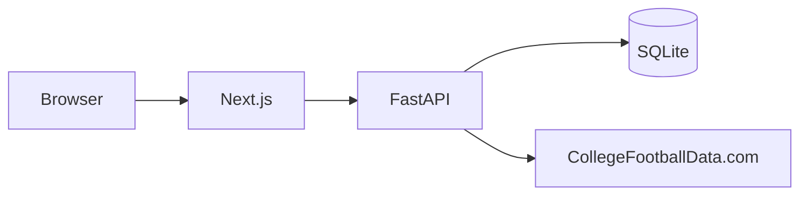

# College Football Intelligence Platform

CFIP is a phase 1 team ledger. An analyst picks a season and a team. The API stores that team's season stats and the UI shows them with a source and a fetch time.

It is not a betting app. It does not predict games. It does not call a language model.

The phase 1 implementation and the documents in `docs/` were produced by a Cursor cloud agent for Chinedu Onyemaobi. He is the product owner. The repo is not a claim that he typed the code line by line.

## Architecture

The browser talks only to the Next.js app. Next.js proxies `/cfip-api` to a FastAPI service. FastAPI reads and writes SQLite. In live mode, a cache miss calls CollegeFootballData.com with a key that stays on the server. In fixture mode, the API reads labeled synthetic files and does not call the network.



Detail, including the terms boundary, is in [docs/02-architecture.md](docs/02-architecture.md).

## Status

| Area | State |
| --- | --- |
| Season and team selection, stored stats, source, timestamp | Implemented |
| Cache so a repeat read does not call the provider | Implemented and tested with a mock and with fixtures |
| Timeouts, retries, long `Retry-After` fail-fast, structured errors, access log with duration | Implemented and unit-tested |
| SQLite schema for later games, matchups, scouting reports, and AI logs | Tables exist. Nothing writes them |
| Fixture mode | Implemented. Numbers are synthetic and labeled. Not football statistics |
| Live CollegeFootballData.com retrieval | Implemented. Not executed here. `CFBD_API_KEY` was unset, so `pytest -m live` skipped |
| Two-team comparison, charts as analysis, analyst notes | Planned. Phase 2 |
| Grounded Q&A, scouting reports, eval set | Planned. Phase 3. No model is called |
| Tool-calling agent and execution metrics | Planned. Phase 4 |
| Public deploy, security review, case study | Planned. Phase 5. This copy is not deployed |
| Postgres | Configuration is accepted by SQLAlchemy. Not tested |

## Setup

Python 3.12 and Node.js 22. No paid account is required to run the tests or the fixture UI.

```bash
python3 -m venv backend/.venv
backend/.venv/bin/pip install -r backend/requirements.txt -r backend/requirements-dev.txt
npm ci --prefix frontend
```

Optional, for live data: copy `.env.example` to `.env` and set `CFBD_API_KEY`. Leave the key out of git.

## Run

Fixture review (no key, synthetic data, banner on the page):

```bash
cd backend
CFIP_DATA_MODE=fixture .venv/bin/uvicorn app.main:app --host 0.0.0.0 --port 43124
```

In another shell:

```bash
cd frontend
npm run dev
```

Open http://127.0.0.1:43123 . The page calls `/cfip-api`, and Next.js proxies that to port 43124.

Live mode, after a key is in the environment or in `.env`:

```bash
cd backend
CFIP_DATA_MODE=live .venv/bin/uvicorn app.main:app --host 0.0.0.0 --port 43124
```

Use a different SQLite file than a fixture session, or delete `backend/data/cfip.db` first. Live and fixture rows are stored under different data sources, but a stale file is confusing.

## Test

```bash
cd backend && .venv/bin/pytest -q
cd frontend && npm test
```

CI is `.github/workflows/ci.yml`. It runs those tests and a frontend production build. It does not call the data provider.

Live smoke, two provider calls, then cache checks. It does not assert statistic values:

```bash
cd backend
export CFBD_API_KEY='your-key'
export CFIP_DATA_MODE=live
.venv/bin/pytest -m live -q
```

### Get a free key

1. Open https://collegefootballdata.com/key (page checked 2026-11-10: email address, no credit card).
2. Put the key from the email in `CFBD_API_KEY`.
3. Run the smoke command above from `backend`.
4. Expect two calls against the free monthly quota of 1,000. A second run inside 24 hours should be served from SQLite if you point it at the same database. The pytest uses a temporary database, so each pytest run spends two calls.

If the smoke test fails, the failure is the verification. Do not replace it with a handwritten stat.

## Environment

| Variable | Role | Default |
| --- | --- | --- |
| `CFBD_API_KEY` | Bearer key. Server only | empty |
| `CFIP_DATA_MODE` | `live` or `fixture` | `live` |
| `CFBD_BASE_URL` | Provider origin | `https://api.collegefootballdata.com` |
| `CFBD_TIMEOUT_SECONDS` | Per-attempt timeout | `20` |
| `CFBD_MAX_RETRIES` | Attempts including the first | `3` |
| `CFBD_BACKOFF_SECONDS` | Base backoff. Doubles each retry | `0.5` |
| `CFBD_CACHE_TTL_SECONDS` | Freshness of a successful refresh | `86400` |
| `DATABASE_URL` | SQLAlchemy URL. Relative SQLite paths resolve under `backend/` | `sqlite:///./data/cfip.db` |
| `CFIP_CORS_ORIGINS` | Used when the browser calls the API directly | local UI origins |
| `CFIP_LOG_LEVEL` | Python log level | `INFO` |
| `CFIP_AUTO_MIGRATE` | Apply Alembic on startup | `true` |
| `CFIP_API_PROXY_TARGET` | Where Next.js sends `/cfip-api` | `http://127.0.0.1:43124` |
| `NEXT_PUBLIC_API_BASE_URL` | Override the UI's API prefix | `/cfip-api` |

## Docs

| Doc | Contents |
| --- | --- |
| [docs/01-product-definition.md](docs/01-product-definition.md) | Problem, users, use cases, MVP, value |
| [docs/02-architecture.md](docs/02-architecture.md) | Components, flow, errors |
| [docs/03-free-technology-assessment.md](docs/03-free-technology-assessment.md) | $0 hosting, data terms, later model choice. Sources and access dates |
| [docs/04-database-design.md](docs/04-database-design.md) | Schema and ER diagram |
| [docs/05-product-backlog.md](docs/05-product-backlog.md) | Epics, stories, acceptance |
| [docs/06-roadmap.md](docs/06-roadmap.md) | Phases, risks, decisions, tests |
| [docs/08-portfolio-value.md](docs/08-portfolio-value.md) | What this shows in a TPM / PM interview |

## Verification on 2026-11-10

Run in this environment. `CFBD_API_KEY` was not set.

Backend (`pytest -q -rs`): 16 passed, 1 skipped. The skip was `tests/test_live_smoke.py`: `CFBD_API_KEY is not set. Live retrieval was not executed.`

Frontend (`npm test`): 5 passed. `npm run build` compiled the Next.js app and prerendered `/`.

The fixture API on port 43124 returned `dataMode: fixture` from `/health`. The first `GET /teams?season=2025` through the UI proxy had `cache.hit` false and the schools Fixture Falcons University, Sample State Polytechnic, and Empty Roster College. The second request had `cache.hit` true. Screenshots of that UI are in [docs/screenshots](docs/screenshots). They are fixture data.

An unauthenticated probe of the provider the same day returned HTTP 401 for `GET /teams` and `GET /stats/season`, and HTTP 404 for `GET /stats/team/season`. No stat payload was returned.

## Data attribution and licensing

Live figures, when a key is configured, come from [CollegeFootballData.com](https://collegefootballdata.com), operated by Rad Sports Analytics LLC. CFIP is not that service, and it is not an official NCAA, conference, or school source.

Their API terms govern the data. The copy read for this project was effective 2026-08-12: [Terms of Use](https://collegefootballdata.com/terms). In short, a private cache and a reasonable display inside a product are allowed. A raw feed, a public database mirror, and a substitute API are not. The key stays on the server. This repository does not contain a key, a raw provider payload, or a dump of their data.

Live API responses use their suggested attribution: "Data provided by CollegeFootballData.com." School names identify the subject of a stored row. Logos are not stored.

The [MIT license](LICENSE) covers this repository's code and documents. It does not license CollegeFootballData.com's data. Files under `backend/fixtures/` are synthetic test data written for this project. They are not CollegeFootballData.com data and must not be cited as football statistics.

A free key, if you want the live path, is requested at [collegefootballdata.com/key](https://collegefootballdata.com/key). Put it in `.env` from `.env.example`. Do not commit it.
