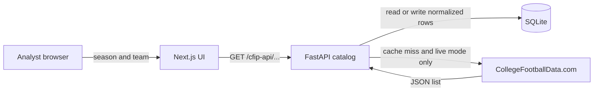

# Architecture

Phase 1 is a monorepo with a browser UI, a Python API, and SQLite. The API is the only component allowed to hold the data-provider key.

## System

The browser calls same-origin `/cfip-api/*`. Next.js rewrites that prefix to the API (`CFIP_API_PROXY_TARGET`, default `http://127.0.0.1:43124`). The key never enters the JavaScript bundle.

Set `NEXT_PUBLIC_API_BASE_URL` only when the browser must call a separate public API host. In that deployment the API's CORS list must name the site, and the key still stays on the API.

## Components

| Component | Responsibility | Does not do |
| --- | --- | --- |
| `frontend` | Season and team selection, loading, empty, and error states, a yardage chart of stored numeric values, source and timestamp | Call CollegeFootballData.com, store the key, invent a zero for a missing stat |
| `backend` FastAPI | Validate the season, normalize provider rows, cache in SQLite, structured errors, request log with duration | Expose raw provider JSON, accept the key from the client |
| SQLite via SQLAlchemy | Teams, season affiliations, stat rows, refresh log. Other tables exist and stay empty | Act as a published mirror of the provider |
| Alembic | Apply the model schema on startup when `CFIP_AUTO_MIGRATE` is true | Generate a second, hand-drifted definition of the tables |
| CollegeFootballData.com | Source of live team and season-stat lists | Official NCAA, conference, or school data. The product says so on every live response |

Fixture mode replaces the provider with `backend/fixtures`. Those files are not recordings. The loader refuses a file that omits `NOT REAL COLLEGE FOOTBALL STATISTICS`. Fixture responses name the provider as `CFIP synthetic fixture`, not as CollegeFootballData.com.

## Request path

1. The UI loads `GET /seasons` (bounds and the default season) and `GET /teams?season=`.
2. The catalog checks the refresh log for a successful row of the same resource, season, team (if any), and origin (`live` or `fixture`) newer than `CFBD_CACHE_TTL_SECONDS` (default 24 hours).
3. On a hit, it reads SQLite. It does not insert another refresh row. The response sets `cache.hit` to true.
4. On a miss in live mode, `CfbdClient` calls `GET /teams?year=` or `GET /stats/season?year=&team=` with a bearer key, a timeout, and retries. See `docs/03-free-technology-assessment.md` for the path check.
5. Normalization keeps identity and stat fields and drops logos, social handles, and any other extra field. Stat tokens that are not finite decimals, including clock strings, stay text and are not charted.
6. Rows are replaced for that team and season, a success row is written to `data_refresh_logs`, and the response is the CFIP contract (`name`, `valueText`, `valueNumeric`), not the upstream object.
7. Choosing a team calls `GET /teams/{id}/stats?season=`. `{id}` is CFIP's key, not the provider's id. The provider id is `externalId`.

An in-process lock per resource stops two overlapping misses from spending two provider calls for the same key. That lock does not coordinate multiple API processes.

## Service boundaries

- The UI and the API deploy separately. The UI does not import the database.
- Postgres is a configuration change (`DATABASE_URL`), not a schema rewrite. Tests run on SQLite only. Postgres is not a verified path.
- AI, matchup notes, and scouting reports have tables and no writers. Phase 3 and 4 should call this API or the database, not the provider, when the needed rows are already stored.
- Request logs are process logs (`method`, `path`, `status`, `duration_ms`) plus the `X-Response-Time-Ms` header. They are not the refresh log. Cache hits show up in the access log and in `cache.hit`, not as refresh rows.

## Failure behavior

Errors use one JSON shape: `error.code`, `error.message`, `error.details`.

| Situation | Code | HTTP |
| --- | --- | --- |
| Key missing | `CFBD_NOT_CONFIGURED` | 503 |
| Provider rejects the key | `CFBD_UNAUTHORIZED` | 502 |
| Provider 429, or `Retry-After` longer than 30 seconds | `CFBD_RATE_LIMITED` | 429 |
| Timeout after retries | `CFBD_TIMEOUT` | 504 |
| Season outside 2004 through the current UTC year | `SEASON_OUT_OF_RANGE` | 422 |
| Unknown team id for the active source | `TEAM_NOT_FOUND` | 404 |

A failed refresh is rolled back and then recorded on `data_refresh_logs`. An empty stat list for a known team is a successful refresh with zero rows, and the UI shows the empty state. An empty team list from the live provider is treated as an upstream failure so a bad response is not cached for a day.

## Why this shape

A single Next.js app could have called the provider from a server function. That was not used. The target architecture is a separate FastAPI service so the later agent, the cache, and the key have one server-side home. Vercel-style hosting of the UI does not run that process. Hosting consequences are in `docs/03-free-technology-assessment.md`.
