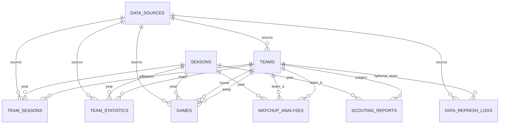

# Database design

SQLite is the phase 1 database. The schema is the SQLAlchemy models in `backend/app/models.py`. Alembic revision `0001_initial` applies that metadata. A test checks that the migrated tables and columns match the models.

Postgres can use the same models later. That switch was not run.

## Why `team_seasons` exists

The requested team entity does not have one conference. CollegeFootballData.com returns the affiliation for the `year` you ask for. One `teams.conference` column would be overwritten when a second season is fetched, and the cache for the first season would lie. `team_seasons` stores conference, division, and classification per team, season, and origin (`live` or `fixture`). `teams` stores the stable identity: provider id, school, mascot, abbreviation, colors.

Logos are not columns. The terms retrieved on 2026-11-10 do not grant logo or trademark rights.

## Entity relationship

## Tables

Phase 1 writes `data_sources`, `seasons`, `teams`, `team_seasons`, `team_statistics`, and `data_refresh_logs`. `games`, `matchup_analyses`, `scouting_reports`, and `ai_execution_logs` are created and unused.

### data_sources

| Column | Notes |
| --- | --- |
| id | PK |
| code | Unique. Seeded values: `cfbd`, `cfip_fixture` |
| name, base_url, terms_url, notes | Reference text, not a copy of a payload |
| created_at | |

### seasons

| Column | Notes |
| --- | --- |
| year | PK |
| created_at | Inserted when a season is first stored |

### teams

| Column | Notes |
| --- | --- |
| id | PK. This is the id in `/teams/{id}` |
| source_id | FK to data_sources |
| external_id | Provider team id |
| school | Required |
| mascot, abbreviation, color, alternate_color | Optional |
| fetched_at | Last identity refresh |

Unique `(source_id, external_id)`. Index on `school`.

### team_seasons

| Column | Notes |
| --- | --- |
| id | PK |
| team_id | FK to teams |
| season_year | FK to seasons |
| conference, division, classification | For that season |
| origin | `live` or `fixture` |
| source_id | FK |
| fetched_at | |

Unique `(team_id, season_year, origin)`. Index on `(season_year, origin)`.

### games

Unused. `source_id`, `external_id` unique together. `season_year` FK. `week`, `season_type`, `start_at`, `home_team_id`, `away_team_id`, points, `neutral_site`, `venue`, `status`, `origin`, `fetched_at`. Index on `(season_year, week)`.

### team_statistics

| Column | Notes |
| --- | --- |
| id | PK |
| team_id, season_year | FKs |
| stat_name | Provider stat name, unchanged |
| stat_value_numeric | `NUMERIC(16,4)` or null |
| stat_value_text | Original token, including commas and clocks |
| conference | As returned on the stat row |
| origin, source_id, fetched_at | |

Unique `(team_id, season_year, stat_name, origin)`. Index on `(season_year, stat_name)`. A refresh deletes that team-season-origin slice and inserts the new rows, so a stat the provider drops does not linger.

### matchup_analyses

Unused. `season_year`, `team_a_id`, `team_b_id`, `summary`, `created_at`. Unique pair. Check that the two team ids differ.

### scouting_reports

Unused. `team_id`, `season_year`, `title`, `body`, `model_name`, `prompt_version`, `grounded`, `created_at`. Index on `(team_id, season_year)`.

### ai_execution_logs

Unused. `started_at`, `finished_at`, `agent_name`, `tool_name`, `status`, `input_hash`, `output_validated`, `error_message`. Index on `started_at`. `input_hash` is a fingerprint. Do not store prompts or the provider key here.

### data_refresh_logs

One row per refresh attempt. Cache hits are not rows.

| Column | Notes |
| --- | --- |
| id | PK |
| source_id | FK, nullable if the source row was missing |
| resource | `teams` or `team_season_stats` |
| season_year | Nullable only for a future non-season resource |
| team_id | Null for the team list. Set for one team's stats |
| status | `success` or `error` |
| origin | `live` or `fixture` |
| http_status | Upstream status when there was an HTTP call. Null for fixtures |
| records_written | Teams or stat rows written |
| duration_ms | Whole attempt, including retries |
| error_code, error_message | On failure |
| rate_limit_remaining | Header snapshot when the provider sent one |
| started_at, finished_at | |

Index on `(resource, season_year, team_id, origin, started_at)`.

`GET /refresh-status?limit=` reads this table, newest first.

## Relationships that matter in phase 1

- A team belongs to one data source. Live teams and fixture teams do not share ids, so a fixture review cannot be labeled as live data from the same rows.
- Stats and affiliations point at a season year and a team.
- The cache key is the latest successful refresh for that resource, season, team, and origin, inside the TTL, and for the team list there must still be affiliation rows.

## Not stored

Raw provider bodies are not stored and not logged. The terms allow a private cache and forbid giving third parties programmatic access to stored raw responses. CFIP's API returns its own fields. That is a product boundary, not a claim that a normalized fact is no longer the provider's data. Live responses still attribute CollegeFootballData.com.
