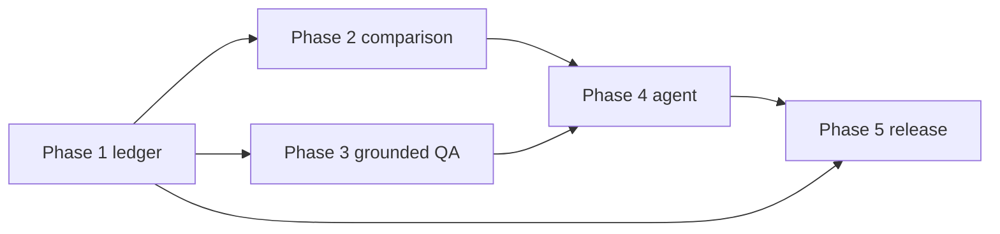

# Roadmap

Five phases, plus a public-data release that was pulled forward on 2026-11-11. Phase 1's code is in the repo. Its live provider check is not done. Comparison, grounded answers, and the agent are not started. Dates below are decision dates, not delivery promises.

The public-data release is ingest of one season and a GitHub Pages snapshot. It is not phase 2's comparison work, and it is not a claim that phase 5's case study or security pass is done. The Pages workflow is in the repo. The public URL was not verified here.

## Phase 1 — Foundation

Select a season and a team. Retrieve that team's season stats through the backend, with source and timestamp.

Depends on: a free CollegeFootballData.com key for the live path. The fixture path has no dependency.

Exit criteria:

- The UI can select a season and a team and render stored stats, or a loading, empty, or error state.
- Repeated reads inside the TTL do not call the provider. Demonstrated with a mock, not with the live provider.
- Refresh rows, attribution, and the response-time header exist.
- Backend and frontend tests pass in CI.
- **Still open:** `pytest -m live` against the real provider. Until that passes, do not say live retrieval works.

## Phase 2 — Analytics

Compare two teams, chart shared numeric stats, persist an analyst note, show attribution on both sides.

Depends on: phase 1 rows for both teams. Does not depend on a model.

Exit criteria from epic E2 in the backlog. A missing stat is blank, not zero. The note is an analyst note.

## Phase 3 — Grounded AI

Natural-language questions and scouting reports that cite stored rows. An evaluation set of at least 25 questions. Report the measured citation count after a run.

Depends on: phase 1 data, the owner's machine specs for Ollama, and `OLLAMA_NO_CLOUD=1`. Does not depend on phase 2, but comparison questions are better after phase 2's tools exist.

Exit: no figure in an answer without a stored `valueText` and `fetchedAt`. Fixture rows stay labeled. The eval count is printed from a run, not written into the README in advance.

## Phase 4 — Agentic workflow

A multi-step tool-calling flow: resolve teams, read stats, compare, draft. Every tool call hits `ai_execution_logs`. A validator sets `output_validated`.

Depends on: phase 3's model choice and phase 1's read API. Phase 2's matchup table is optional.

Exit: a measured log summary (calls, passes, failures) from one recorded run. Failed validation does not get edited into a pass.

## Phase 5 — Portfolio release

Tests already required in phase 1 stay required. Add a security pass (key not in git, bundle, or logs; no raw provider body on the public API), deploy to the hosting row chosen in `docs/03-free-technology-assessment.md`, and a case study that matches the verification record.

Depends on: phases 1–4 for a full case study. A phase-1-only case study is allowed if it says the later phases are not built. Depends on the owner's accounts for Cloudflare, Render, and Neon if a public URL is in scope.

Exit: CI green on the deployed revision, the security checklist filled with what was inspected, and the case study free of unverified stats.

## Dependency sketch

Phase 5 can ship a honest phase-1 slice without waiting for phase 4. The full case study waits.

## Risk register

| Risk | Why it matters | Response |
| --- | --- | --- |
| No API key in this environment | Live retrieval is untested | Fixture mode is labeled. README gives the key steps. Smoke test is skipped, not faked |
| 1,000 calls per month | A public uncached demo spends the key | 24-hour cache. The Pages ingest is three calls for one season, not one call per team. No `/info` probe |
| Terms forbid a raw mirror | A pass-through API would violate the terms retrieved 2026-11-10 | Normalized CFIP contract only. Raw bodies are not stored |
| Current season is incomplete | Users read a partial total as a full season | Default season is the previous calendar year. Copy says the current season can be incomplete |
| Render disk is ephemeral | SQLite on Render disappears on sleep | The public demo does not use Render. It is a static snapshot. A later API host would still need an external database. Local demo uses SQLite |
| Free hosts sleep or pause | An interview link looks broken | Say the cold start out loud, or run locally |
| Hosted "free" LLM limits were ambiguous | Building phase 3 on the wrong quota | Ollama local is the default. Groq Developer numbers are not copied onto the Free plan |
| Logos and school marks | Terms grant no trademark rights | No logos. Names identify the stat subject |
| Fixture numbers quoted as real | Destroys the portfolio | Banner, provider name, and the phrase `NOT REAL COLLEGE FOOTBALL STATISTICS` |
| Agent code described as the owner's typing | Misstates the work | Portfolio doc and README say an AI coding agent wrote this slice under his direction. Product direction is Chinedu's |
| A public snapshot becomes a raw mirror | Terms forbid a substitute API | One season, FBS on a live load, CFIP fields only, betting keys refused, file not committed |
| Pages is not enabled | The workflow cannot change the repo setting | README names the settings URL. Until it is on, there is no public site |
| A visitor quotes the fixture page | The first public build has no key | The banner and the snapshot both say `NOT REAL COLLEGE FOOTBALL STATISTICS` |

## Decision log

| Date | Decision | Reason |
| --- | --- | --- |
| 2026-11-10 | CollegeFootballData.com is the only data source | Free key, documented terms, season team stats from 2004. No scrape |
| 2026-11-10 | Do not proxy raw JSON | Terms section 5, retrieved that day |
| 2026-11-10 | `team_seasons` in addition to `teams` | Conference is per season. One column would corrupt the cache |
| 2026-11-10 | Separate live and fixture sources | A review database must not be labeled as the provider |
| 2026-11-10 | Cache TTL default 24 hours | Protects the 1,000-call month |
| 2026-11-10 | Fail a `Retry-After` above 30 seconds immediately | A monthly reset must not hold an HTTP request open |
| 2026-11-10 | SQLite locally, Postgres URL later, Neon only if a public demo needs persistence | Render's free disk does not persist. Postgres was not tested |
| 2026-11-10 | No betting routes | The product is not a betting app, even though the provider has lines |
| 2026-11-10 | No logos stored | Terms do not grant those rights |
| 2026-11-10 | Ollama local is the later model default. No model is called now | Hosted free-tier numbers were not cleanly labeled, and prompts should stay on the machine |
| 2026-11-10 | UI talks to the API through a Next.js rewrite | One public origin, key stays on the server |
| 2026-11-10 | Alembic applies model metadata instead of a hand-copied DDL | One schema definition. A test compares migrated columns to the models |
| 2026-11-11 | Public demo is a GitHub Pages snapshot, not Render plus Neon | Same GitHub account, no card, no sleeping API. Visitors do not call the provider. A live FastAPI host stays optional and is not set up |
| 2026-11-11 | Ingest one season in three calls, previous calendar year, FBS | Protects the 1,000-call month and keeps the public copy to a bounded display |
| 2026-11-11 | Recorded test bodies are synthetic, not provider captures | CI has no key, and the repo does not store their payloads |
| 2026-11-11 | `GET /games` does not call the provider | The schedule is loaded by the ingest command. A page view cannot spend the quota |

## Testing strategy

| Layer | What it covers | What it does not cover |
| --- | --- | --- |
| Unit | Stat parsing, team normalization, retry and rate-limit behavior, chart series, grouping | Real football figures |
| API integration | Fixture mode end to end, cache, error shape, mocked "live" path with the synthetic file as the upstream body | The real provider |
| Migration | Alembic upgrade creates the model tables and columns on SQLite | Postgres |
| Live smoke | Marked `live`. Skipped unless `CFBD_API_KEY` is set. Asserts the contract and that the second read is cached. Does not assert stat values and does not write the body into git | More than one season, more than two provider calls |
| UI | Loading, empty, and error states are in the component. Automated coverage is the pure view-model. The running UI was checked in a browser only for the session recorded in the README | A hosted browser farm |
| CI | Backend pytest and frontend vitest, plus a frontend production build | The live marker, unless a key is added as a secret on purpose. Do not add the key to the repo |

A measured result is a command output or a provider response observed in that run. A fixture assertion is a test of our code against a file we wrote. Those are not interchangeable.
